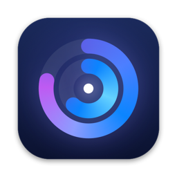
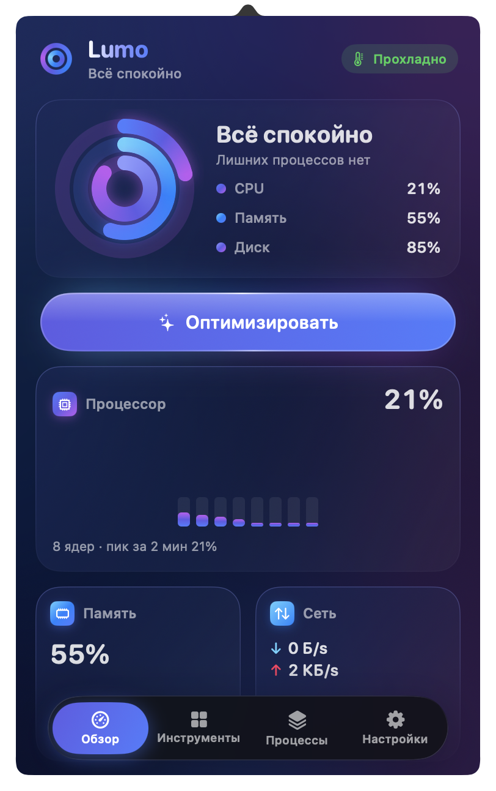
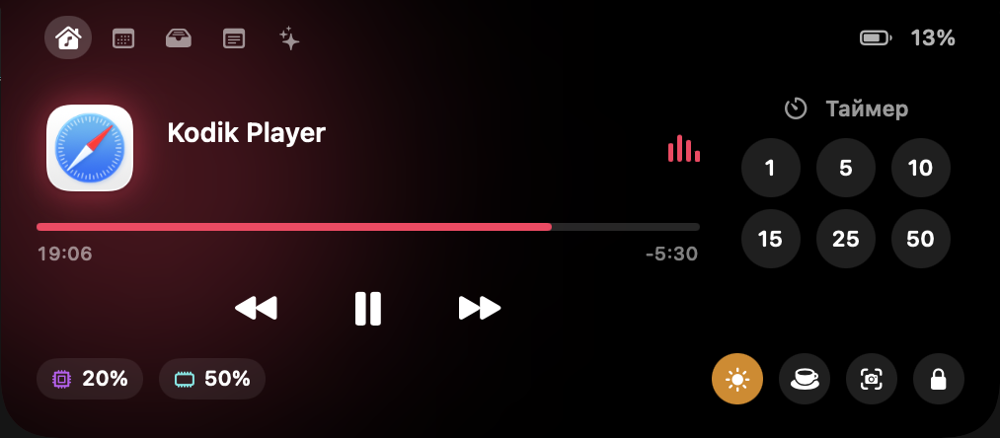

<p align="center">
  
</p>

<h1 align="center">Lumo</h1>

<p align="center">
  A menu bar app that keeps your Mac fast — and replaces a drawer full of little utilities.<br>
  Native, private, free. Turn on only what you use.
</p>

<p align="center">
  <a href="#install">Install</a> ·
  <a href="#everything-it-does">Features</a> ·
  <a href="#private-by-default">Privacy</a> ·
  <a href="CHANGELOG.md">Changelog</a> ·
  <a href="SUPPORT.md">Support</a>
</p>

<p align="center">
  <a href="../../releases"></a>
  
  
  <a href="LICENSE"></a>
</p>

<p align="center">
  
  
</p>

Lumo started as a one-click optimizer: it watches CPU, memory and disk, finds what is weighing your Mac down and stops it safely. It grew into a set of everyday tools — a Dynamic Island, window management, clipboard history, screen capture, a per-app volume mixer and more — all behind one menu bar icon. Every tool is off until you switch it on, and each one asks only for the permissions it needs.

## Install

1. Download **Lumo.dmg** from [Releases](../../releases).
2. Open it and drag **Lumo** onto **Applications**.
3. The first time only: Lumo is not signed with a paid Apple Developer ID, so macOS stops it once. Open Lumo, click **Done**, then go to **System Settings → Privacy & Security** and click **Open Anyway**. If the button isn't there:
   ```bash
   xattr -dr com.apple.quarantine /Applications/Lumo.app
   ```

Requires macOS 14 Sonoma or later. One universal app for Apple silicon and Intel.

> Because the build is ad-hoc signed, macOS forgets granted permissions after each update. Turn them on again under **Lumo → Tools → Permissions**.

## Everything it does

Thirty tools in eight groups. Each one is a switch on the **Tools** tab, and each can be removed entirely on the **Features** page.

### Keep the Mac fast
- **One-click optimize.** The animated button finds runaway processes and heavy apps and stops them safely, then shows a report: what was stopped, how much memory came back and what restarted on its own.
- **Cleanup intensity dial** from gentle to aggressive, and **auto-optimize** when the load stays above your threshold.
- **Processes.** The heaviest apps and background processes right now, with "stop now" and "never touch". Idle third-party apps are listed separately.
- **Cleaner** for caches, logs (`~/Library/Logs`), Xcode builds, old downloads and leftovers of removed apps, on demand or quietly once a week. Everything goes to the Trash, so it can be restored.
- **Uninstaller.** Search for an app and remove it together with the preferences, caches and containers it left behind.
- **Sensors.** Chip and SoC temperatures, every sensor on demand, GPU load, whole-system power draw in watts, the apps using the most energy (macOS Energy Impact) and fan speed in RPM with a manual mode. Fan changes go through macOS's administrator prompt; passively cooled Macs say so.
- **Network.** Live download and upload, totals for this session, local IP and Apple's built-in speed test with responsiveness under load.
- **Menu bar readouts** for CPU, memory, GPU, network, temperature, fan, power and battery: as numbers or bars, with text beside the icon and an optional shimmer.
- **Alerts** for sustained CPU load, memory pressure, low disk, low battery and overheating.
- **Updates** in one list: Homebrew formulae and casks (search and install by name), App Store updates through `mas`, and apps that update themselves through their own Sparkle feeds.
- **Messenger downloads** from Telegram, WhatsApp, Viber and WeChat: see the size, move old files to the Trash, sort the rest into folders, or clear them weekly.

### Sound
- **Volume mixer.** Volume per app, boost past 100%, a different output device per app and favorites pinned in your order.
- **Outputs.** Next output with ⌃⌥⌘O, a preferred device Lumo switches back to whenever it is connected, and a quieter volume when headphones disconnect so speakers don't blast the room.
- **Microphones.** Keep a preferred microphone, set its input level and mute every mic at once with ⌃⌥⌘M — one press for calls.
- **Music launch blocker.** ▶︎ on the keyboard or headphones no longer opens Music when nothing is playing; Lumo counts how many launches it stopped.

### Windows and the Dock
- **Window layout.** Halves, quarters, thirds, maximize, center, restore and move to the next display with ⌃⌥ shortcuts; drag a window to an edge or corner to snap it; ⌃⌥-drag moves a window from anywhere inside it and ⌃⌥⇧-drag resizes it.
- **App switcher** that replaces ⌘Tab: big live previews, search by name, one tile per window, arrows to move, Q to quit the selected app and a "this display only" filter.
- **Dock previews** of every window on hover, with switch, close and snap — windows from every desktop included.
- **Dock clicks.** Clicking the active app's icon minimizes its windows, hides the app or cycles through its windows.
- **Green button** fills the screen without creating a new Space; **Spaces keep their order** instead of rearranging by use; **quit when the last window closes** for apps you choose.
- **⌘Q / ⌘W protection.** Hold or press twice to quit apps or close windows and tabs, with a list of apps to leave alone.

### Keyboard and mouse
- **Scrolling.** Smooth scrolling that glides like a trackpad, linear scrolling with a fixed number of lines per notch, sideways scrolling while holding a key, reversed mouse scrolling (the trackpad stays as is) and no pointer acceleration.
- **Mouse buttons.** Back and forward on buttons 4 and 5, actions on the middle button and on wheel tilt, middle-button gestures for Spaces and Mission Control, and a three-finger trackpad press as a middle click.
- **Focus follows mouse.** The window under the pointer comes forward after a short pause.
- **Extra click filter** for worn mouse buttons and **key debounce** that filters doubled letters.
- **Super key.** Caps Lock or a right-hand modifier acts as ⌃⌥⇧⌘ when held, and as its own key when tapped alone, with per-app exclusions.
- **Shortcuts page.** Every Lumo shortcut in one place, rebindable and resettable, plus an optional takeover of ⌘⇧3/4/5 for Lumo's own capture tools.

### Clipboard, files and links
- **Clipboard history** with search, pins, a ⇧⌘V panel that pastes straight into the app, a retention limit and **auto-clear** after a delay, on lock or on sleep.
- **Paste as plain text** with ⌥⇧⌘V; the original clipboard is put back afterwards.
- **Snippets.** Type a shortcut such as `;addr` in any app and it expands; `{date}`, `{time}` and `{clipboard}` are filled in.
- **Shelf** for files, text and links: shake the pointer while dragging, press ⌃⌥⌘S, or drop onto the notch.
- **Clean links.** Copied links lose `utm_`, `fbclid`, `gclid`, `si` and other tracking tags automatically, with a counter.
- **Finder shortcuts.** ⌘X then ⌘V moves files, F2 renames, and ⌘V pastes an image from the clipboard as a PNG file.
- **Disk image installer.** When a mounted DMG contains an app, Lumo offers to install it, eject the image and move the `.dmg` to the Trash.

### Dynamic Island
A panel around the notch — or a simulated notch on Macs and displays without one — that grows on hover and opens on click.
- **Now playing** from any player, with artwork, a scrubber, playback controls, an optional live equalizer and synced lyrics.
- **Live activities** beside the notch: music, timer, screen recording and download progress; finished downloads land on the shelf.
- **Tabs:** music and timer, calendar with a meeting heads-up five minutes before and a Join button, notifications, the files shelf, a scratchpad, AI agent limits and a camera mirror.
- Optional haptic feedback, and a toggle on ⌃⌥⌘N.

### Everyday tools
- **Command Bar** on ⌥Space: one field for apps, files, windows, menu commands of the front app, clipboard history, snippets, a calculator, unit conversion, emoji, your own shell scripts and every Lumo action.
- **Quick panel** on ⌃⌘V: a palette of favorite Lumo actions in the middle of the screen.
- **Radial menu** on ⌃⌥⌘R: a wheel around the pointer with folders and per-app profiles.
- **Notes** in a floating scratchpad that stays on top (⌃⌥⌘;).
- **AI agents.** Token use for Claude Code, Codex, OpenCode and Copilot by day and project, Claude and Codex plan limits, the API value of your usage, and a heads-up when an agent worked for two minutes and went quiet.
- **Cleaning mode** locks the keyboard and media keys so you can wipe them; the mouse stays free to press "Done".
- **Quick toggles:** Dark Mode, desktop icons, hidden files, eject all disks, sleep the display, lock the screen, empty the Trash.

### Capture
- **Lumo selector** (⌃⇧1–5) with a mode bar and a pixel loupe: area, window, full screen, **scrolling screenshots**, recording, text and color.
- **Screenshot editor:** arrows, boxes, highlighter, redaction, crop, backgrounds, a watermark, the Share menu, save to the Desktop and a 24-hour link.
- **Screen recording** of an area, a window or the whole screen, with the pointer, system audio and the microphone on separate tracks.
- **Recording editor:** trim the ends, cut a section, blur an area, auto-zoom on clicks, then save as MP4 or GIF or share a 24-hour link.
- **Text and QR codes** from anything on screen, a **color picker** with formats and recent colors, pinned screenshots and a **camera mirror** to check yourself before a call.
- **Media tools:** compress video to HEVC 1080p or 720p, make GIFs, convert and resize images with an optional watermark, and pull text out of them — all on this Mac, saved next to the originals.

### Energy and displays
- **Stay awake** until you stop it, on a timer, while chosen apps are open, while plugged in or while an external display is connected — and with the lid closed.
- **Displays:** brightness for every screen including external monitors over DDC/CI, ½ and ¼ steps for the brightness keys, dimming below the minimum and XDR extra brightness on displays with HDR headroom.
- **Bluetooth off during sleep** and back on at wake — only if Lumo was the one that turned it off.

### Install only what you use
Remove any feature on the **Features** page — it stops running and leaves the panel; adding it back restores its settings. Start from a preset (Essentials, Power user or Everything), reorder or hide sections, switch to a compact three-per-row grid, and export your settings to another Mac. The **Permissions** page shows what each permission is for, which of your features use it, and when one is no longer needed so you can revoke it.

### Default shortcuts

| Action | Shortcut |
|---|---|
| Window halves | ⌃⌥ ← → ↑ ↓ |
| Window quarters | ⌃⌥ U · I · J · K |
| Window thirds | ⌃⌥ D · F · G |
| Maximize · center · restore | ⌃⌥ ↩ · ⌃⌥ C · ⌃⌥ ⌫ |
| Next display | ⌃⌥⌘ → |
| Capture area · window · text · color · record | ⌃⇧ 1 · 2 · 3 · 4 · 5 |
| Command Bar | ⌥ Space |
| Clipboard history · paste as plain text | ⇧⌘V · ⌥⇧⌘V |
| Quick panel | ⌃⌘V |
| Radial menu · shelf · notes | ⌃⌥⌘ R · S · ; |
| Next output · mute microphones | ⌃⌥⌘ O · M |
| Dynamic Island | ⌃⌥⌘ N |

All of them can be changed or turned off on the **Shortcuts** page.

## Private by default

No account, no analytics, no tracking. Lumo works on your Mac; the network is used only for things you can see — update checks, the speed test, Homebrew, opt-in lyrics, opt-in Claude limits and 24-hour links you create. Details: [Privacy](docs/PRIVACY.md) · [Permissions](docs/PERMISSIONS.md).

## Safety model

Lumo only stops processes it can prove are yours and third-party. System processes, other users' and root processes, anything started from Terminal, the app in front of you and anything you shield are never touched. Apps are asked to quit like ⌘Q so you can save; background processes get `SIGTERM`, and `SIGKILL` only at intensity 80% and above.

**Passwordless purge.** `purge` needs root. With **Settings → No password**, macOS asks for your admin password once and Lumo installs `/etc/sudoers.d/lumo`, allowing exactly three commands and nothing else:

```
<you> ALL=(root) NOPASSWD: /usr/sbin/purge, /usr/bin/dscacheutil -flushcache, /usr/bin/killall -HUP mDNSResponder
```

The rule is validated with `visudo` and activated atomically. Fan speed and lid-closed mode use macOS's own administrator prompt each time and keep no lasting privileges.

## Build it yourself

Xcode 16 or newer (Swift 6 toolchain).

```bash
git clone https://github.com/Leidone/lumo.git
cd lumo
swift test                 # the core logic test suite
./scripts/build_dmg.sh     # → build/Lumo.app and build/Lumo.dmg
```

The script runs the tests, builds a universal release binary and the two small helpers (`Helpers/`), renders the icon, ad-hoc signs the app and packs the DMG with `Install Instructions.txt`. See [Contributing](CONTRIBUTING.md) for the layout and conventions.

## When something misbehaves

[Troubleshooting](docs/TROUBLESHOOTING.md) covers launch problems, permissions and missing features. Otherwise see [Support](SUPPORT.md); security issues go through [Security](SECURITY.md).

## License

[MIT](LICENSE) © 2026 [Leidone](https://github.com/Leidone). The license covers the source code; the Lumo name and icon are covered by [TRADEMARKS.md](TRADEMARKS.md). Third-party services and system frameworks are listed in [THIRD_PARTY_NOTICES.md](THIRD_PARTY_NOTICES.md).
